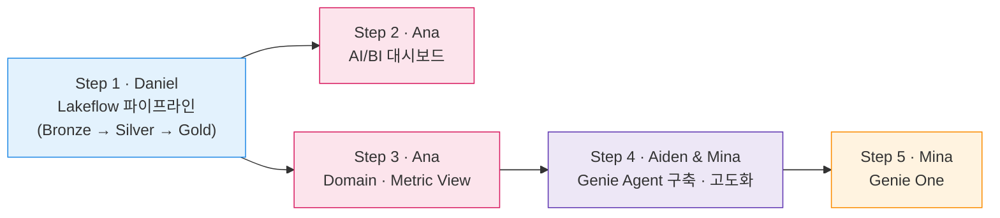

# Wanderbricks 시나리오 & 페르소나

## 1 - Wanderbricks는 어떤 회사인가요?

**Wanderbricks**는 전 세계 여행자와 숙소 호스트를 연결하는 온라인 휴가용 숙소 예약 마켓플레이스입니다. Airbnb, Booking.com과 같은 여행·호스피탈리티 플랫폼을 모델로 한 가상의 회사로, 다음과 같은 특징을 가지고 있습니다.

- **전 세계 고객:** 165개국의 약 12만 명의 고객이 Wanderbricks에서 숙소를 예약합니다.
- **두 가지 고객 유형:** 여가 목적의 **개인 고객(individual)**과, 법인 계정으로 출장·단체 숙소를 예약하는 **비즈니스 고객(business)**이 거의 절반씩을 차지합니다.
- **예약의 생애주기:** 하나의 예약은 **pending(대기)** → **confirmed(확정)** → **completed(숙박 완료)** 순으로 진행되며, 도중에 **cancelled(취소)**될 수 있습니다.
- **뚜렷한 계절성:** 여름(6~8월)과 연말(12월)에 예약이 집중됩니다.

## 2 - Wanderbricks가 마주한 문제

최근 Wanderbricks의 경영진 회의에서는 같은 질문에 대해 매번 다른 숫자가 나왔습니다.

> *"지난 분기 매출이 얼마였죠?"*
>
> 재무팀은 숙박이 끝난 예약만 집계한 숫자를, 마케팅팀은 취소된 예약까지 포함한 총 예약 금액을 가져왔습니다. 두 숫자는 10배 가까이 차이가 났습니다.

문제는 여기서 끝나지 않았습니다.

- **흩어진 데이터:** 고객, 예약, 리뷰 데이터가 각각 다른 곳에 원본 그대로 쌓여 있어, 분석할 때마다 정제 작업을 반복해야 했습니다.
- **SQL마다 다른 KPI:** "VIP 고객", "예약 전환율" 같은 지표가 대시보드 SQL 안에만 정의되어 있어, 사람마다 다른 기준으로 계산했습니다.
- **데이터 팀 의존:** 마케팅 임원이 간단한 질문을 하나 하려 해도 데이터 팀에 요청하고 며칠을 기다려야 했습니다.
- **풀리지 않은 의문:** 2025년 7월, 환불 정책을 바꾼 직후 취소율이 크게 올랐지만, 정책 문서에서 예상한 범위를 넘었는지 아무도 바로 답하지 못했습니다.

| 상황 | 과제 | 행동 | 결과 |
|---|---|---|---|
| 데이터는 흩어져 있고, 지표 정의는 사람마다 다름 | 신뢰할 수 있는 단일 데이터 기반과 공통의 비즈니스 정의 마련 | Databricks 위에 파이프라인 → 대시보드 → 시맨틱 레이어 → AI 에이전트를 구축 | 현업이 자연어로 질문하고, 조직 전체가 같은 숫자를 보게 됨 |

## 3 - Wanderbricks 데이터 팀을 소개합니다

이 실습에서 여러분은 아래 네 명의 페르소나가 되어 Wanderbricks의 문제를 해결합니다.

{ width="120" align=right }

### 🛠️ Daniel - Data Engineer

*"원천 데이터는 매일 쌓이는데, 분석팀이 믿고 쓸 수 있는 테이블은 아직 없어요."*

**일상 업무:**

- 여러 원천 시스템의 데이터를 수집하고 적재
- 결측값과 잘못된 값을 정제하는 스크립트 관리
- 데이터 품질 이슈에 대한 문의 대응

**담당:** Step 1

{ width="120" align=right }

### 📊 Ana - Data Analyst

*"같은 KPI를 대시보드마다 다시 계산하다 보니, 숫자가 서로 맞지 않아요."*

**일상 업무:**

- 경영진과 현업을 위한 대시보드 제작
- 반복되는 데이터 추출 요청 처리
- KPI 정의와 계산 로직 관리

**담당:** Step 2, Step 3

{ width="120" align=right }

### 🤖 Aiden - AI Engineer

*"현업이 직접 질문할 수 있는 AI를 만들고 싶지만, 틀린 답을 내놓을까 봐 걱정이에요."*

**일상 업무:**

- 사내 AI 에이전트와 애플리케이션 구축
- AI 답변 품질 평가와 개선
- 정형·비정형 데이터를 AI에 연결

**담당:** Step 4

{ width="120" align=right }

### 📈 Mina - Marketing Executive

*"캠페인 성과를 바로 확인하고 싶은데, 매번 데이터 팀에 요청하고 기다려야 해요."*

**일상 업무:**

- 국가·세그먼트별 마케팅 캠페인 기획과 예산 배분
- 캠페인 목표 대비 실적 점검
- 경영진 보고를 위한 매출 지표 확인

**담당:** Step 4.2, Step 5

## 4 - 실습 여정

네 명의 페르소나는 아래 순서로 각자의 결과물을 만들고, 앞 단계의 결과물을 이어받아 다음 단계를 진행합니다.

준비가 끝났다면 [Step 1) Lakeflow 파이프라인 구축](../01-lakeflow-pipeline/index.md)으로 이동해 Daniel의 업무를 시작합니다.
