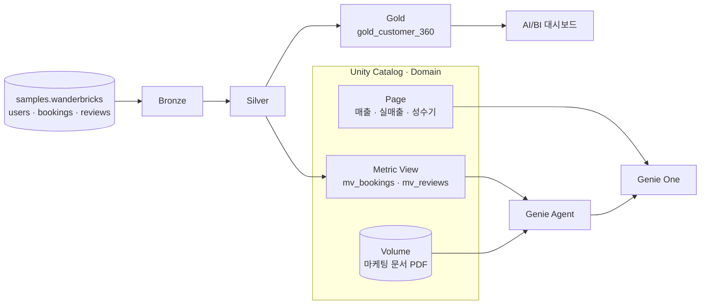

# Wanderbricks Hands-on Lab

**Databricks 위에서 원천 데이터부터 AI 에이전트까지, 데이터 & AI 플랫폼을 엔드투엔드로 직접 구축해 봅니다.**

## 워크숍 개요

**Wanderbricks**는 전 세계 여행자와 숙소 호스트를 연결하는 가상의 온라인 휴가용 숙소 예약 마켓플레이스입니다. 이 실습에서 여러분은 Wanderbricks 데이터 팀의 네 명의 페르소나가 되어, 각자의 역할에서 Databricks를 사용해 하나의 데이터 & AI 플랫폼을 완성합니다.

- 데이터 엔지니어로서 예약·고객·리뷰 데이터를 수집하고 정제하는 **파이프라인**을 만듭니다.
- 데이터 분석가로서 **대시보드**를 만들고, 비즈니스 지표를 **거버넌스가 적용된 Metric View**로 정의합니다.
- AI 엔지니어로서 마케팅 임원이 자연어로 질문할 수 있는 **Genie Agent**를 만들고, 현업 피드백과 평가로 정확도를 높입니다.
- 마케팅 임원으로서 **Genie One**에서 비즈니스 질문을 던지고 신뢰할 수 있는 답을 받습니다.

실습 데이터는 모든 Databricks 워크스페이스에 기본 제공되는 샘플 데이터 `samples.wanderbricks`를 사용하므로, 별도의 데이터 준비 없이 바로 시작할 수 있습니다.

## 실습 여정

| Step | 실습 | 페르소나 | 핵심 기능 | 예상 소요 시간 |
|---|---|---|---|---|
| 1 | 예약·고객·리뷰 데이터를 Bronze → Silver → Gold로 정제 | Daniel · Data Engineer | Lakeflow Spark Declarative Pipelines | TBD |
| 2 | 고객 360 대시보드 만들기 | Ana · Data Analyst | AI/BI 대시보드, Genie Code | TBD |
| 3 | 비즈니스 지표를 Domain과 Metric View로 정의 | Ana · Data Analyst | Unity Catalog Domain, Metric View | TBD |
| 4 | 마케팅용 Genie Agent를 만들고 고도화 | Aiden · AI Engineer, Mina · Marketing Executive | Genie Agent, Monitoring, Benchmark, Page, Volumes | TBD |
| 5 | 자연어로 비즈니스 질문하기 | Mina · Marketing Executive | Genie One | TBD |

## 아키텍처

## 이 실습에서 사용하는 Databricks 기능

-   :material-pipe: **Lakeflow Spark Declarative Pipelines**

    ---

    SQL 몇 줄로 스트리밍 수집, 데이터 품질 검증(Expectations), 증분 처리를 선언적으로 구현합니다.

-   :material-chart-box: **AI/BI 대시보드**

    ---

    직접 위젯을 구성하거나, Genie Code에 한 번의 프롬프트로 대시보드를 만들게 할 수 있습니다.

-   :material-book-open-variant: **Unity Catalog Semantics**

    ---

    Metric View로 KPI를 한 번 정의하고, Domain과 Page로 비즈니스 맥락을 조직 전체에 공유합니다.

-   :material-robot: **Genie Agent**

    ---

    특정 데이터에 맞춰 구성한 자연어 분석 에이전트입니다. Monitoring과 Benchmark로 정확도를 관리합니다.

-   :material-chat-question: **Genie One**

    ---

    워크스페이스 전체의 데이터와 비즈니스 정의를 바탕으로 질문에 답하는 대화형 인터페이스입니다.

## 시작할 준비가 되셨나요? 🎯

- [ ] Databricks 워크스페이스에 로그인할 수 있습니다.
- [ ] 카탈로그를 만들 수 있는 권한이 있거나, 관리자에게 미리 요청해 두었습니다. 자세한 내용은 [사전 준비](00-introduction/prerequisites.md)에서 확인합니다.
- [ ] 약 TBD시간 동안 실습에 집중할 수 있습니다.

준비가 되었다면 [소개](00-introduction/index.md)로 이동해 실습을 시작합니다.
